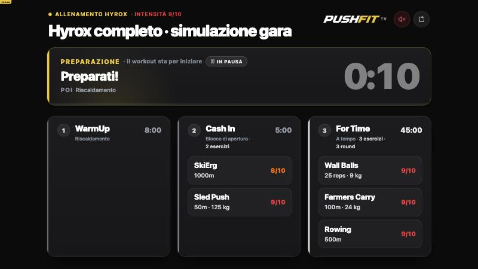

# Tornare indietro: la nuova TV (attesa + carosello)

Se la nuova TV non piace, ecco come rimettere **quella di adesso** senza perdere nient'altro.
Scritto il 26/11/2026, **prima** di toccare il codice: la nuova TV per ora esiste solo come
prototipo in `tools/design-tv/` (proposta D).

## Com'è la TV di adesso

| Prima del collegamento | Con un workout |
|---|---|
|  |  |

Testata col titolo, fascia del timer, blocchi in una griglia di carte (3 per riga, 2 righe se
servono). Storia e regole: `docs/memoria/scheda-workout.md`, sezioni «9-tv-grafica»,
«9-tv-persone», «9-tv-qr».

## Il punto di partenza

- Ultimo commit prima della nuova TV: **`b87619d`** («Assegnato a»: poche righe e un foglio con
  tutti gli atleti; proposte di design della TV; captcha nel backlog). È **già su GitHub**, su
  `app` e su `main`: anche perdendo questo Mac il punto di ritorno resta.
- Su quel commit c'è un tag locale: **`tv-prima-del-redesign-2026-11-26`** (solo su questo Mac,
  non su GitHub).

## Cosa toccherà la nuova TV (quindi cosa rimettere)

1. **La grafica della TV**: `src/components/TVDashboardUI.jsx` e, se serve, la parte di
   disposizione in `src/pages/TVDashboard.jsx` (griglia `cols`/`rows`, scala 1920×1080).
   Timer, beep, audio e canale realtime di `TVDashboard.jsx` **non** devono cambiare.
2. **La pausa dopo il Cash In e prima del Cash Out**, che finisce quando si preme Avanti sul
   telefono: cambia la sequenza del timer sul telefono (`src/lib/timerSequence.js`, probabilmente
   `src/lib/avanzaTimer.js` e `src/pages/WorkoutDetail.jsx`). Questa parte **arriva anche nelle app
   sugli Store**, non solo sul sito.

Le due cose vanno messe in **commit separati**: così si può tornare indietro su una sola.

> ✅ **Fatto il 26/11/2026.** File nuovi della TV: `src/lib/schermoTV.js`, `src/useAdattaTesto.js`,
> `src/lib/__tests__/schermoTV.test.js`, `src/components/__tests__/RigaCartaTV.test.jsx` (al posto di
> `EsercizioTV.test.jsx`, da rimettere tornando indietro), e in fondo a `src/index.css` il blocco
> `.locandina-lista`. La pausa: `src/lib/timerSequence.js` (`pausePrima`) e due righe in
> `src/pages/WorkoutDetail.jsx` (`pause: true` nel `timer_state` e il testo «Pausa: quando siete
> pronti, premi Avanti.»). Tornando alla TV di prima con la pausa ancora attiva, `schermoTV.test.js`
> va tolto insieme ai file della grafica.

## Caso 1 — non ancora salvato su GitHub

Si rimettono solo i file della TV com'erano al tag (le modifiche di altre sessioni restano):

```bash
git checkout tv-prima-del-redesign-2026-11-26 -- src/components/TVDashboardUI.jsx src/pages/TVDashboard.jsx
```

E, se è già stata toccata anche la pausa del timer:

```bash
git checkout tv-prima-del-redesign-2026-11-26 -- src/lib/timerSequence.js src/lib/avanzaTimer.js
```

🔴 `src/pages/WorkoutDetail.jsx`, `CLAUDE.md` e `docs/memoria/scheda-workout.md` **non** vanno
ripristinati così: contengono anche lavori di altre sessioni. Prima si guarda cosa è cambiato:

```bash
git diff tv-prima-del-redesign-2026-11-26 -- src/pages/WorkoutDetail.jsx
```

e si tolgono a mano solo le righe della nuova TV e della pausa.

Se sono stati aggiunti file nuovi (per esempio componenti del carosello), si vedono con:

```bash
git status --short
```

e si cancellano solo quelli della nuova TV.

## Caso 2 — già salvato su GitHub (branch `app`)

Si trovano i commit della nuova TV:

```bash
git log --oneline tv-prima-del-redesign-2026-11-26..app
```

⚠️ L'elenco mostra **anche gli altri lavori** fatti dopo il 26/11: quelli **non** si annullano.
Si sceglie solo il commit (o i commit) della nuova TV, e lo si annulla con un commit nuovo che lo
disfa, senza cancellare niente dalla storia:

```bash
git revert <sha-del-commit-della-nuova-tv>
```

```bash
git push origin app
```

Per annullare solo la grafica e tenere la pausa (o il contrario) si fa il `revert` solo del
commit che serve: per questo vanno separati.

## Caso 3 — già pubblicata sul sito (`main`)

La TV gira **dal sito** (`/tv` su `pushfit.it`), non dall'app: arriva con `app:main`.

- **Subito, in un minuto**: su Vercel, *Instant Rollback* al deploy precedente. Torna indietro
  tutto il sito a quel momento, quindi va usato solo come tampone.
- **Per bene**: il `revert` del Caso 2, poi lo si porta sul sito (solo su richiesta del
  committente, CLAUDE.md §1.1):

```bash
git push origin app:main
```

## ⚠️ Se la pausa è già nelle app sugli Store

Un'app sugli Store con la pausa può parlare con la TV di adesso: la TV vecchia non conosce la
fase «pausa» e la mostra con il colore di riserva (il giallo, `ACCENTO_TEMA` di
`TVDashboardUI.jsx`) e il testo che il telefono manda. Funziona, ma va **provato** prima di
pubblicare: telefono nuovo, TV di adesso, arrivare alla pausa dopo il Cash In.

Togliere la pausa dal telefono, invece, richiede una **nuova versione** sugli Store: il sito
non basta.

## Controllo finale

Dopo il ritorno, nell'ambiente di prova (`npm run demo`): `/tv` in una scheda, un workout con
`?tv=<codice>` nell'altra. La TV deve somigliare alle due immagini sopra. Poi:

```bash
npm test
```
